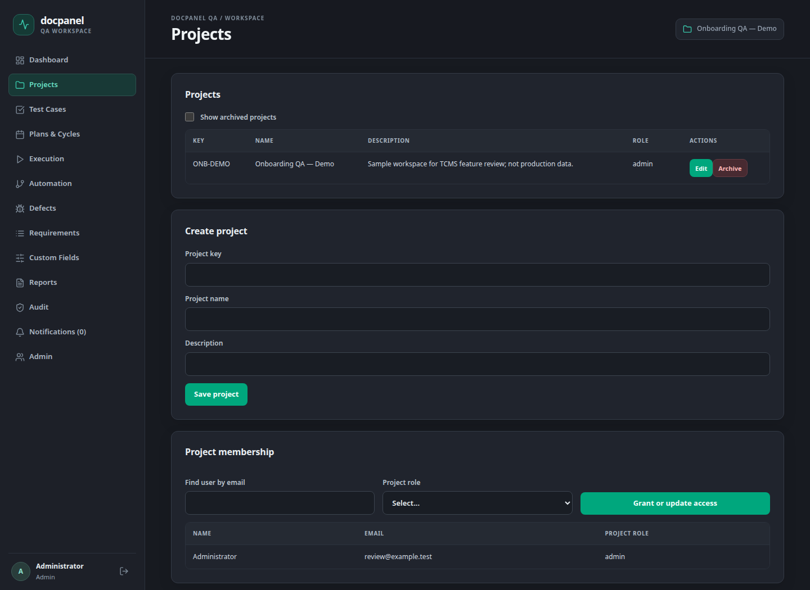
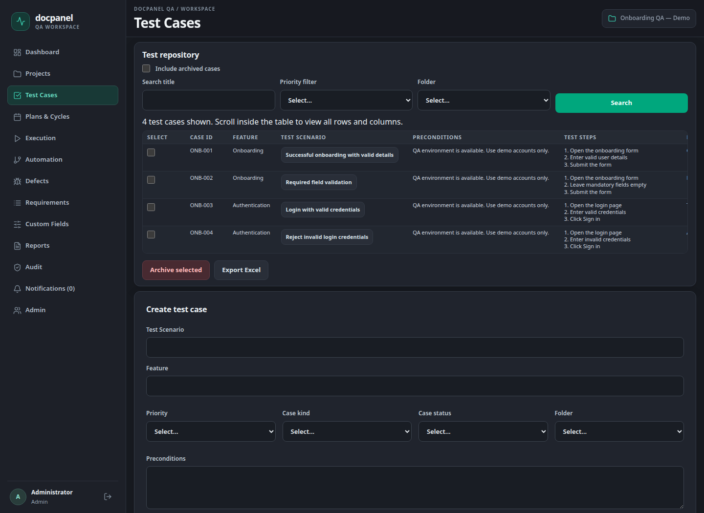
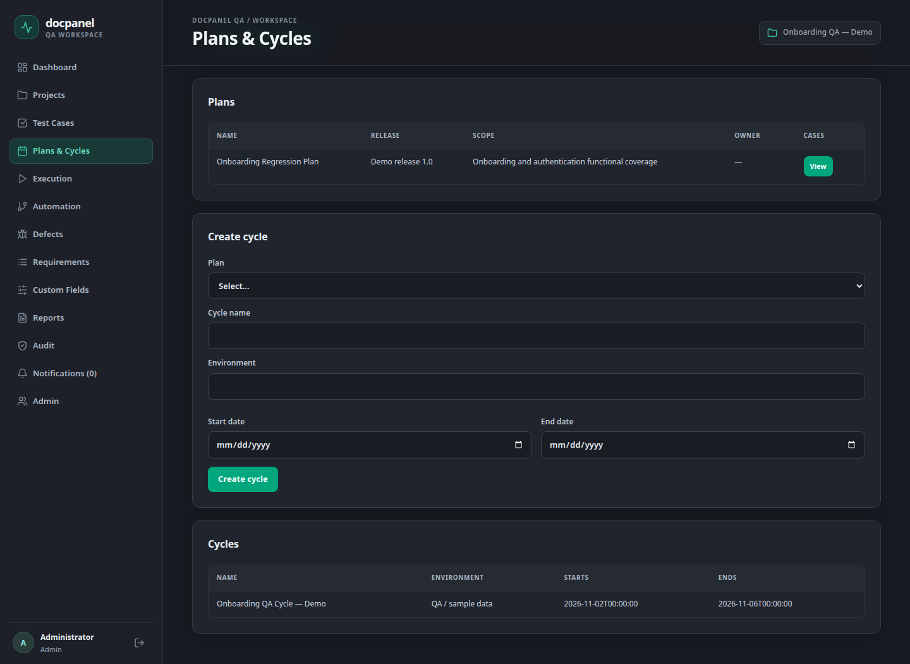
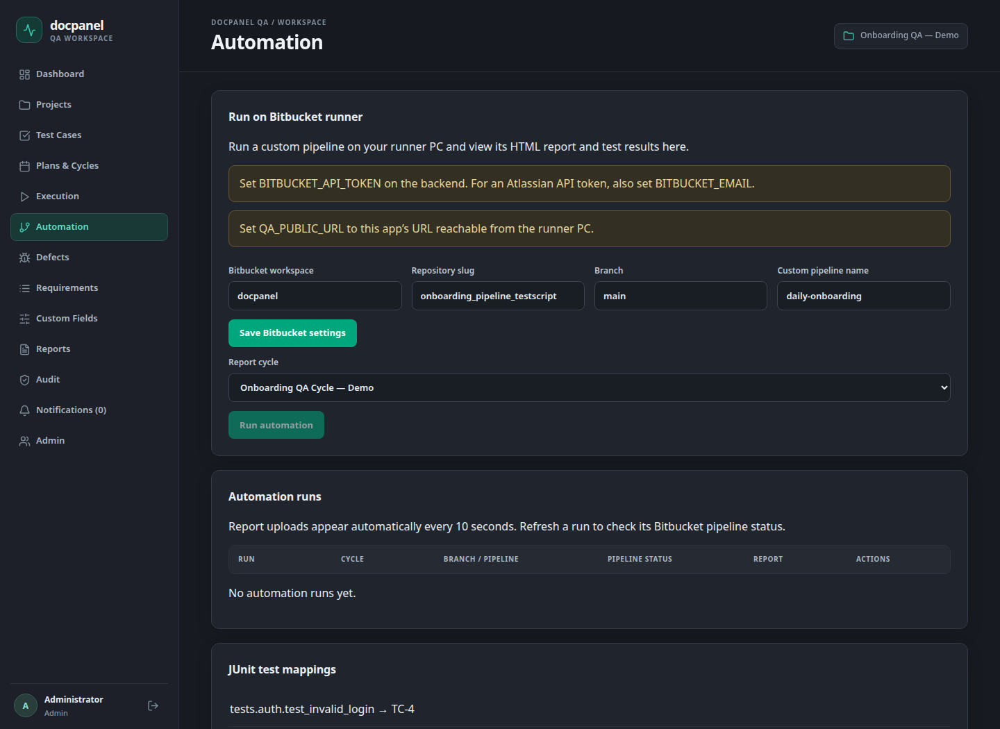

# TCMS Progress Summary
Date: 02 November 2026

Projects, Test Cases and Cycles are implemented. Automation integration is implemented in code; the live Bitbucket run is pending.

Screenshots show the actual application with sample demo data.

## 1. Project Management

Work completed:

- Create and edit projects with a project key, name and description.
- Add team members and assign project roles.
- Archive projects and restore them when needed.

Status: Project management features implemented.

## 2. Test Cases

Work completed:

- Create and edit test cases with steps, expected results and priority.
- Search and filter cases; organize them using folders.
- Import/export Excel files and keep case version history.
- Archive selected cases and restore them.

Status: Test case management features implemented.

## 3. Test Plans & Cycles

Work completed:

- Create test plans with release, scope and selected test cases.
- Create cycles with environment, start date and end date.
- Add cases to a cycle, assign testers and record execution results.
- Keep execution attempt history for each cycle.

Status: Plan, cycle and manual execution features implemented.

## 4. Automation

Work completed:

- Added the screen to configure Bitbucket repository, branch and pipeline.
- Implemented pipeline trigger, status refresh and run history.
- Map automated tests to TCMS cases and import JUnit results.
- Added HTML report viewing and cycle result updates.

Status: Automation code implemented. Live Bitbucket execution and report return are pending validation.
