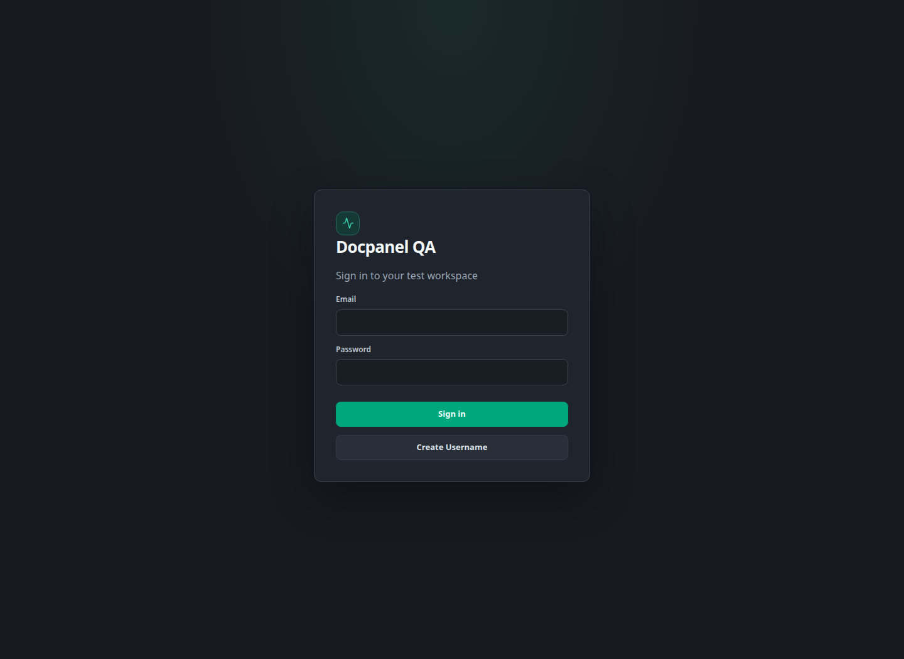
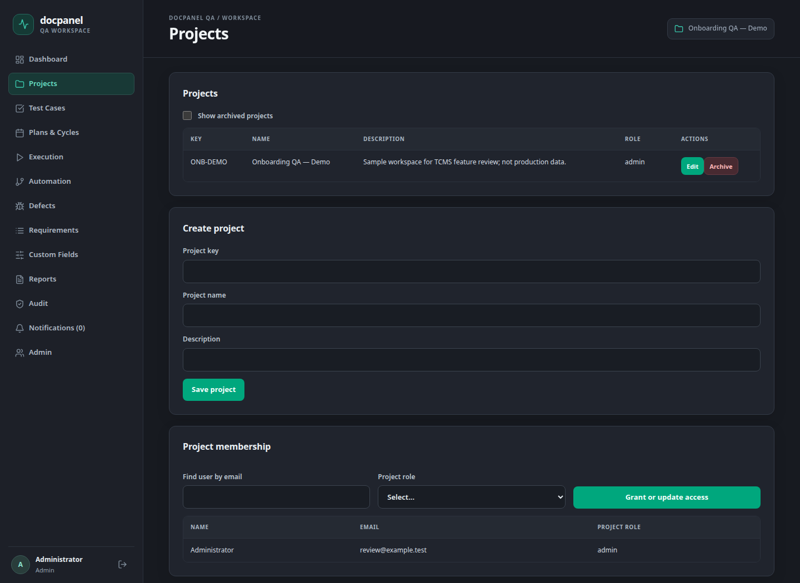
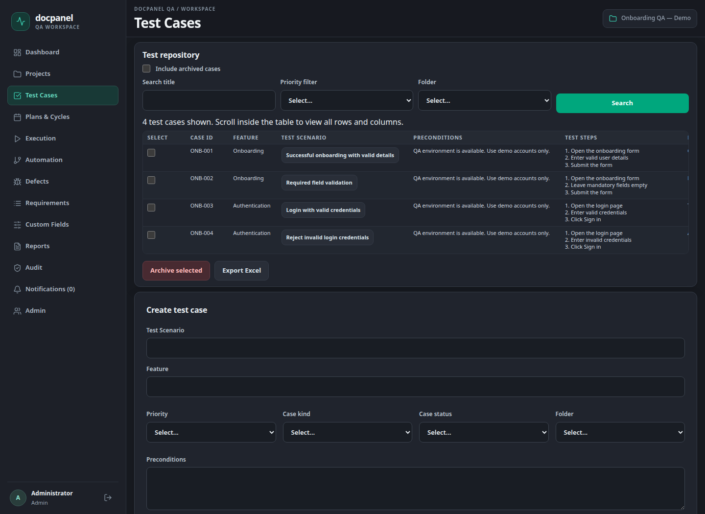
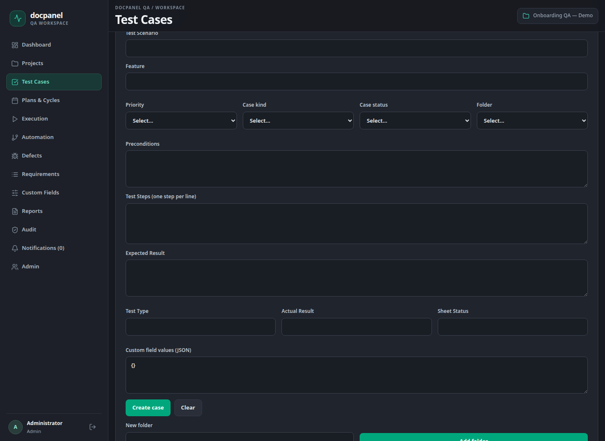
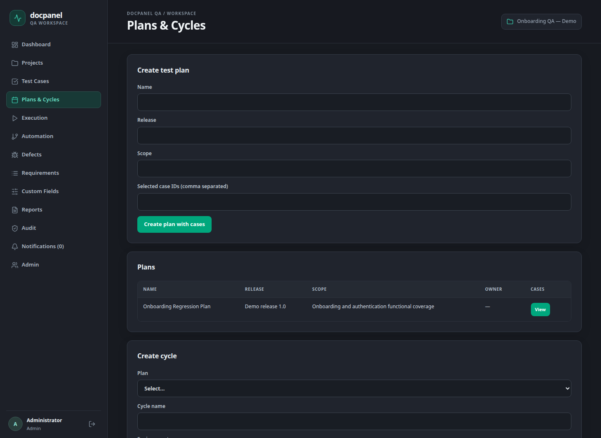
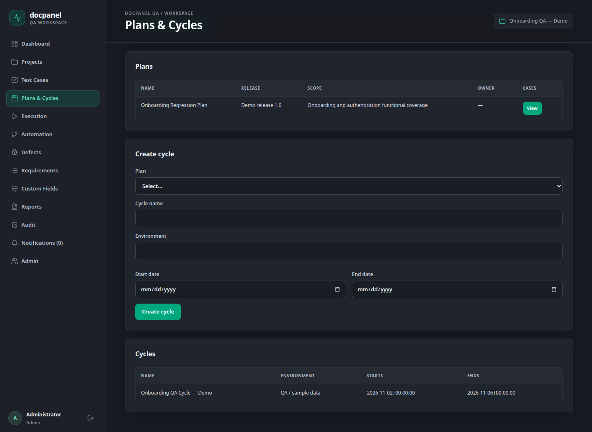
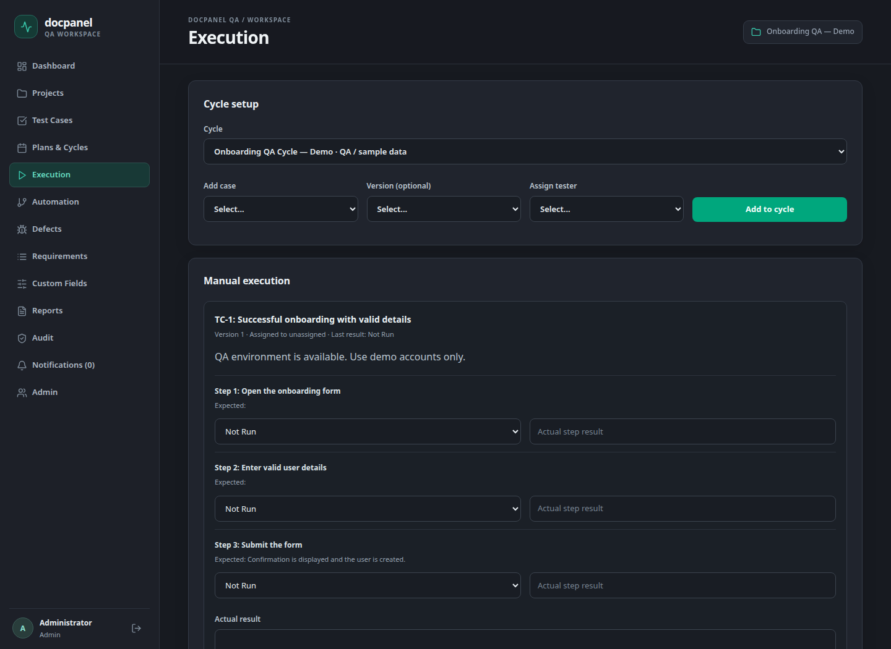
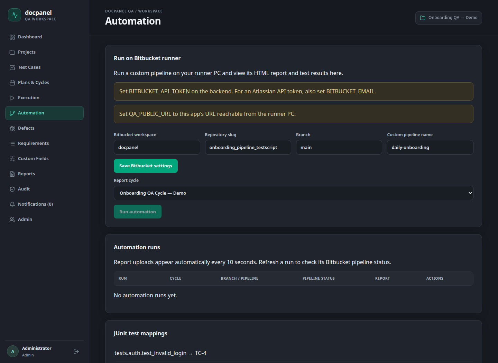
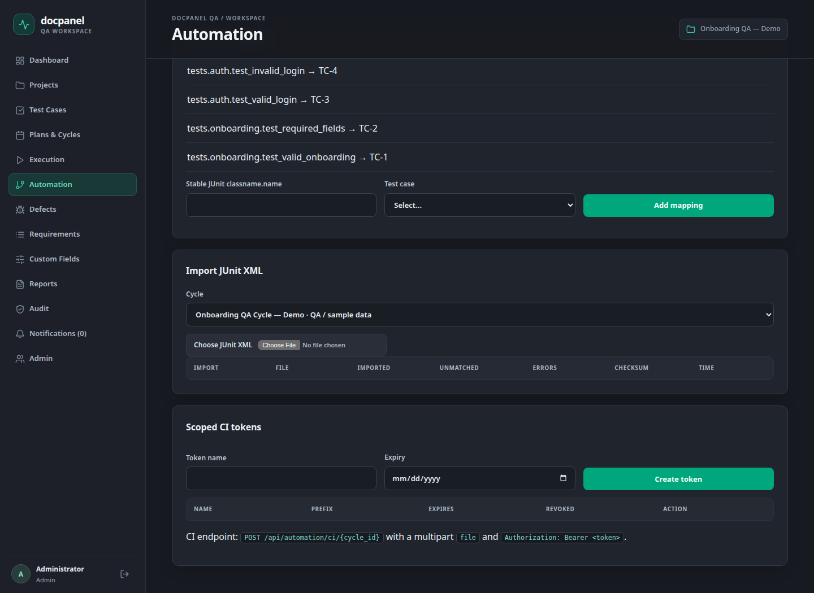

# Docpanel QA — TCMS Work Review and Bitbucket Access Request
Date: 02 November 2026

# TCMS Work Review

Docpanel QA | Prepared for project stakeholders and repository / infrastructure administrators | 02 November 2026

Purpose: present the work implemented in Project Management, Test Cases, Plans & Cycles, and Automation; show the current UI; and request the access required to enable real Bitbucket execution from TCMS.

Application name: Docpanel QA / TCMS. “DCMS” in the discussion is treated as this same application; no separate DCMS integration has been verified.



Evidence note: all UI screenshots use synthetic demo data on a temporary SQLite instance. They show the repository’s actual React UI, not recovered customer projects or a production deployment. No Bitbucket pipeline was triggered for this document. No passwords or token values are included.


---

## 1. Work completed and current status

| Area | Implemented in the repository | Current validation / dependency |
| --- | --- | --- |
| Projects | Create/edit, unique project key, archive/restore, project membership and roles. | Demonstrated using a synthetic project. |
| Test Cases | Create/edit versions, step details, filters/folders, Excel import/export, archive/restore. | UI captured; backend workflow tests passed. |
| Plans & Cycles | Plan scope/release/case selection; cycle environment/dates; case assignment. | Demo plan, cycle and case links created successfully. |
| Automation | Bitbucket pipeline dispatch/status, JUnit mapping/import, execution results, HTML report viewer. | Local tests use mocked Bitbucket responses. Live integration still requires access and setup. |
| Database configuration | Single .env file with DB_HOST, DB_PORT, DB_NAME, DB_USER and DB_PASSWORD. | Configured PostgreSQL is unavailable on this PC. Main backend login is blocked. |

Implemented means functionality exists in the current working tree. It does not mean every change is deployed, merged into the separate automation repository, or proven against the live Bitbucket workspace.

## Verification performed for this review

- Backend: python -m pytest tests -q — 34 passed; one dependency deprecation warning.
- Frontend: npm run build — TypeScript check and Vite production build passed.
- Demo: project, four test cases, one plan, one cycle, cycle case links, four mappings and Bitbucket settings were created via the actual API.
- Nine UI screenshots were captured from the isolated app. Main .env settings and existing databases were not changed for the screenshots.
## Current blocker

The configured local PostgreSQL connection refuses connections, so the main backend does not finish startup. The earlier login HTTP 500 is consistent with the frontend proxy being unable to reach the backend. MariaDB is installed under XAMPP but was stopped; no MySQL data deletion or reinstall was performed. MySQL support is not implemented in the current application configuration.


---

## 2. Project Management

Completed: create projects with a unique key, name and description; edit project details; archive and restore projects; list archived projects; and grant or update project membership. Project roles include admin, lead, tester and viewer. Server-side checks restrict project access and privileged actions.



User flow: Projects → enter key/name/description → Save project → find the team member by email → select project role → Grant or update access. Archive retains the project record rather than deleting its history.

Value delivered: project-specific organization and access for test assets, cycles and results.


---

## 3. Test Case repository

Completed: project-specific repository, search by title, priority/folder filters, selection and bulk archive, restoration, case version history, Excel export, and Excel import with import feedback. The grid shows source case ID, feature, scenario, preconditions, steps, expected result, priority, type and status information.



Excel import accepts .xlsx workbooks up to 5 MB, including the worksheet columns Feature, Test Scenario, Preconditions, Test Steps, Expected Result, Priority, Test Type, Actual Result and Status. Imported worksheet result/status fields remain source information; execution attempts are recorded separately.


---

## 4. Create and maintain Test Cases

Completed: create a case with scenario, feature, priority, Manual/Automated/Both classification, Active/Draft/Deprecated status, folder, preconditions, plain-text steps and expected result. Editing saves a new version; earlier versions remain available. Custom field values can be entered as JSON.



User flow: select project → Test Cases → Create test case → fill scenario and test details → Create case. Use Edit / Save new version for changes and History to inspect prior versions.

Value delivered: a reusable case library for manual execution and stable automation mappings.


---

## 5. Test Plans

Completed: create a test plan with name, release and scope; select cases using comma-separated case IDs; list plans and inspect plan cases. Plans group test coverage before execution cycles are created.



User flow: Plans & Cycles → enter plan name/release/scope → enter selected case IDs → Create plan with cases. Plan and case ownership are checked within the project.

Current UI limitation: plan case selection uses IDs; a richer searchable case selector is a possible future UI improvement, not completed work.


---

## 6. Create Cycle

Completed: create a cycle under a plan, specify name and environment, schedule start/end dates, and list cycles. The API rejects an end date before the start date. Cycle case membership and tester assignment are managed through the Execution page.



User flow: select Plan → enter Cycle name and Environment → choose dates → Create cycle → open Execution to add cases and assign testers. Creating a cycle does not automatically execute tests or add every plan case.

Value delivered: release/environment-specific test execution tracking while retaining the case version selected for execution.


---

## 7. Cycle execution and results

Completed: choose a cycle, add project cases, assign a project member, record manual overall and step results, and view execution attempt history. Each cycle case initially has no attempt (Not Run). Results use Passed, Failed, Blocked or Skipped; repeated executions are separate attempts.



Automation imports create execution attempts with source Automation for mapped cases in the selected cycle. Project-level execution CSV reporting is available under Reports.

UI limitation: the optional version selector is present, but its option list is not populated in this screen; the API supports selecting a case version and defaults to the current version.


---

## 8. Automation implementation

Completed: save project Bitbucket workspace/repository/branch/custom pipeline; choose a report cycle; trigger a custom pipeline; list run history; refresh remote pipeline status; open Bitbucket logs; import JUnit results; and view a returned self-contained HTML report inside TCMS.



Intended flow: TCMS → Bitbucket custom pipeline → self-hosted runner PC → automated tests → JUnit XML + HTML upload → TCMS cycle execution results and reports.

Run history reloads every 10 seconds for received reports. Refresh status explicitly queries Bitbucket. A completed pipeline without a callback is shown as No report received. Network uncertainty is recorded as DISPATCH_UNCONFIRMED rather than claiming a successful dispatch.


---

## 9. Automation mappings, imports and tokens

Completed: map a stable JUnit classname.name identifier to a TCMS test case; review imported/unmatched test identifiers and import errors; reject duplicate manual imports; keep separate execution attempts for distinct automation runs. XML input is capped at 5 MB; returned HTML is capped at 10 MB.



| Credential | Created where / purpose |
| --- | --- |
| Bitbucket API token | Created in Atlassian account settings; allows backend pipeline trigger/status requests. TCMS does not create this personal token. |
| TCMS scoped CI token | Created under Automation → Scoped CI tokens; authorizes project-scoped JUnit imports into TCMS. This does not grant Bitbucket access. |
| Per-run callback token | Generated automatically by TCMS when triggering a run. Scoped to that run/cycle, expires after 24 hours, sent as a secured pipeline variable. |


---

## 10. Bitbucket access request

Request: approve connecting TCMS to the automation repository so authorized QA leads can trigger the existing onboarding pipeline and receive the run’s test results and HTML report in the selected TCMS cycle.

| Requested item | Required access / intended use | Owner to confirm |
| --- | --- | --- |
| Target repository | docpanel/onboarding_pipeline_testscript; branch main; custom pipeline daily-onboarding. These values come from local onboarding notes and must be confirmed. | Repository owner |
| Integration account | An approved Atlassian account/service identity with access to the target repository and permission to run its pipelines. | Workspace/repository admin |
| API token scopes | read:pipeline:bitbucket and write:pipeline:bitbucket for pipeline status and dispatch. These scopes do not replace the account’s repository access. [R1–R3] | Account owner / admin |
| Pipeline code changes | Permission to submit/merge bitbucket-pipelines.yml and scripts/upload_junit.py into the automation repository. Branch protection/PR approvals still apply. | Repository maintainer |
| Runner | Use the registered self-hosted Linux Shell runner with self.hosted, linux.shell and kiwi labels. Admin assistance only if registration or labels must change. [R4] | Runner administrator |
| Network / app URL | Runner can reach TCMS callback URL; backend can reach api.bitbucket.org over HTTPS. Provide an approved HTTPS/VPN/reverse-proxy URL for QA_PUBLIC_URL. | Infrastructure administrator |
| Secret ownership | Approved secure delivery/storage, expiry and rotation owner for the Bitbucket credential. Store only on the backend. | Account owner / infrastructure |

No token was created and no access request was sent externally during this work. This document is the reviewable request for the relevant owners. The runtime integration needs pipeline scopes; repository code-update permissions are a separate maintainer responsibility.


---

## 11. Create and configure the Bitbucket token

An authorized account owner can create the scoped API token. The current backend already supports an Atlassian email + API token using Basic authentication. [R1, R2]

1. Sign in to the approved Atlassian account that has access to the automation repository.
1. Open Atlassian Account → Security → Create and manage API tokens → Create API token with scopes.
1. Use a clear integration name (for example TCMS onboarding integration) and an approved expiry date; select Bitbucket as the application.
1. Select read:pipeline:bitbucket and write:pipeline:bitbucket; review and create the token.
1. Copy the token directly into approved secret storage / backend configuration. Do not place it in screenshots, this document, source control or runner logs.
1. Set the backend variables below and restart the backend after the database connection is restored.
```text
BITBUCKET_EMAIL=<approved-atlassian-account-email>
BITBUCKET_API_TOKEN=<scoped-token-from-account-owner>
QA_PUBLIC_URL=https://<approved-tcms-host>
```

Repository/workspace access tokens are an alternative authentication path supported by the code using Bearer authentication with BITBUCKET_EMAIL left empty. Availability and administration depend on the organization’s Bitbucket setup; scoped Atlassian API token instructions above are the primary request.

## Runner and repository configuration

- Copy docs/onboarding-bitbucket-pipelines.yml to the automation repository as bitbucket-pipelines.yml and include scripts/upload_junit.py. Review the changes through the repository’s normal process.
- Confirm runner labels, environment dependencies, test command, JUnit and self-contained HTML output paths. The supplied onboarding template retains resume logic and HTML/Excel/screenshot artifacts.
- TCMS passes QA_RUN_ID, QA_CALLBACK_URL and secured QA_CALLBACK_TOKEN for each run. The upload helper returns JUnit and HTML even when pytest fails; do not override or log the token.
QA_PUBLIC_URL cannot be localhost when the runner is on another PC. Repository browsing and pipeline configuration creation remain outside this TCMS UI.


---

## 12. Planned work and acceptance criteria

| Order | Work to complete | Completion evidence |
| --- | --- | --- |
| 1 | Restore the configured PostgreSQL service or agree a supported hosting/database approach. MySQL would require a separate compatibility implementation. | Main /api/health returns database ok; login works with the intended project data. |
| 2 | Obtain repository access, token scopes, runner confirmation and an approved callback URL. | Owners confirm access; backend loads secrets without exposing them. |
| 3 | Merge the pipeline and report helper into the automation repository; map the real stable JUnit identifiers. | main contains the reviewed files; mappings match actual test identifiers. |
| 4 | Run a small onboarding cycle from TCMS with the registered runner. | TCMS run links to the real Bitbucket build; pipeline runs on the expected PC. |
| 5 | Validate results, HTML and failure handling end to end. | Mapped results reach the selected cycle; HTML opens; failed tests, unmatched tests, missing callbacks and retry behavior are checked. |
| 6 | Complete stakeholder UAT and operational handover. | Project/case/cycle/automation walkthrough signed off; backup, expiry/rotation and support ownership agreed. |

## Acceptance walkthrough

- Create a project, grant tester access, create/import cases, and save a new case version.
- Create a plan and dated cycle; add cases; assign a tester; record a manual execution attempt.
- Save Bitbucket settings; trigger the custom pipeline; confirm runner execution and received XML/HTML.
- Confirm report access follows project membership and repeated callback uploads do not duplicate execution attempts.

---

## 13. Source evidence and references

Local sources: frontend/src/App.tsx; frontend/src/pages/TestCases.tsx; frontend/src/pages/AutomationRunner.tsx; backend/app/main.py; backend/app/test_cases.py; backend/app/bitbucket.py; backend/app/config.py; backend/tests/; docs/BITBUCKET-AUTOMATION.md; docs/onboarding-bitbucket-pipelines.yml; scripts/upload_junit.py.

[R1] Atlassian — Create an API token: https://support.atlassian.com/bitbucket-cloud/docs/create-an-api-token/

[R2] Atlassian — REST authentication: https://developer.atlassian.com/cloud/bitbucket/rest/intro/

[R3] Atlassian — Pipelines REST API: https://developer.atlassian.com/cloud/bitbucket/rest/api-group-pipelines/

[R4] Atlassian — Runner labels/configuration: https://support.atlassian.com/bitbucket-cloud/docs/configure-your-runner-in-bitbucket-pipelines-yml/

Official token and pipeline references checked on 02 November 2026. Account policies and the live repository/runner state require confirmation by their owners.
